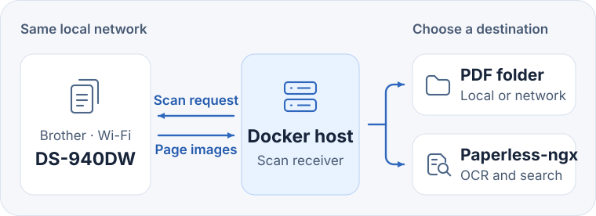
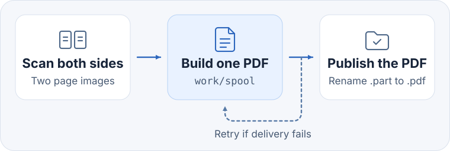
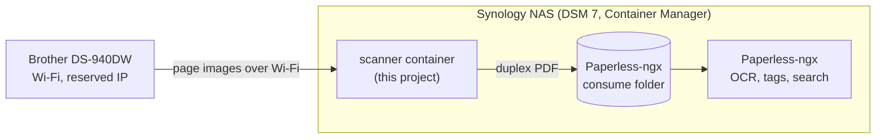

# Brother DS-940DW Wi-Fi Scan Receiver

[](https://github.com/ogmm/ds-940-paperless-scanner/actions/workflows/ci.yml)
[](LICENSE)


**Hands-free scan-to-folder for the Brother DS-940DW.** Insert a sheet and both sides arrive as one PDF in a folder, on a NAS share, or in [Paperless-ngx](https://docs.paperless-ngx.com/). You don't need a phone app, a computer, or a button press.

A small Docker container on your NAS or home server takes the place of Brother's scanning app on the local network. It waits for paper in the feeder, scans both sides, and delivers one complete PDF per sheet.

[Quick start](#quick-start) · [Reference setup: Synology + Paperless-ngx](#reference-setup-synology-nas-and-paperless-ngx) · [Configuration](#configuration) · [FAQ](#faq) · [Docker guide](docs/docker.md)



## Why this project exists

The DS-940DW is a compact duplex document scanner with built-in Wi-Fi. Over Wi-Fi, each scan is started from Brother's iPrint&Scan app on a phone or computer, and the pages are saved on that device. Unattended scanning straight into a network folder is usually a feature of larger and more expensive network document scanners.

We bought the DS-940DW to sit on a shelf and file mail, invoices, and receipts, and then found that it could not do that on its own. Instead of returning it, we wrote this receiver. It runs Brother's own Linux driver in a container and acts as the scanning client, so the scanner can feed a folder or a document archive without anyone opening an app.

## Features

- **Scans when paper is inserted.** With an empty feeder the receiver checks again every three seconds. A sheet in the feeder starts the scan.
- **One PDF per sheet.** Both sides in color at 300 dpi. A4 is the default, with optional automatic size detection or Legal.
- **Any folder as the destination.** A local directory, an SMB or NFS share mounted on the host, or the Paperless-ngx consume folder for OCR and full-text search.
- **Only complete files in the destination.** The PDF is built in a local spool and appears in the destination under its final name after it is fully written. If the share is unavailable, the receiver keeps the PDF and tries again.
- **Recovers on its own.** It waits out a powered-off scanner, a busy session, or a paper jam, and restarts the driver process if it stops responding.
- **Locked-down container.** Read-only filesystem, no Linux capabilities, unprivileged user. The Brother driver package is checked against a pinned SHA-256 during the build.
- **Optional Paperless-ngx stack.** A Compose overlay adds Paperless-ngx, PostgreSQL, and Valkey if you don't run Paperless yet.

## Requirements

- **Scanner:** Brother DS-940DW connected to your router over Wi-Fi, with a reserved IPv4 address. [Brother wireless setup](https://support.brother.com/g/b/producttop.aspx?c=gb&lang=en&prod=ds940dw_us_eu_as)
- **Host:** x86-64 (amd64) Linux with Docker Engine and Docker Compose v2, on the same LAN as the scanner. For example an Intel or AMD based Synology NAS with DSM 7, a mini PC, or a virtual machine.
- **Not supported:** ARM hosts, because Brother's driver used here is built for amd64. Docker Desktop on macOS and Windows is untested. The receiver relies on Linux [host networking](https://docs.docker.com/engine/network/drivers/host/).

## How it works

1. The receiver registers the scanner's IP address with Brother's `brscan5` SANE driver and opens a scan session.
2. If the feeder is empty, the driver reports that there are no documents. The receiver closes the session, waits three seconds, and asks again.
3. When a sheet is present, the receiver captures the front and the back and builds a PDF in `work/spool`.
4. It writes the PDF into the output folder under a temporary name and renames it to `brother-YYYYMMDD-HHMMSS-xxxxxxxx.pdf` (UTC time) once the write succeeds.
5. Paperless-ngx, a sync client, or you pick up the finished file. If delivery fails, the PDF stays in the spool and is offered again every 30 seconds.



A supervisor process watches the scan worker. It restarts the worker after three consecutive errors or when the worker shows no progress for three minutes. When the scanner is off, busy, or jammed, the receiver waits between 20 and 90 seconds before the next attempt.

## Quick start

On the Docker host, download the project and create the working and output directories.

```sh
git clone https://github.com/ogmm/ds-940-paperless-scanner.git
cd ds-940-paperless-scanner
mkdir -p work consume
cp .env.example .env
```

Edit `.env` and set at least these three values. `id -u` and `id -g` print the IDs of the account that created the directories.

```ini
# The scanner's reserved IPv4 address (example value)
SCANNER_IP=192.168.1.50
# A user and group that can write to work/ and consume/
SCAN_UID=1000
SCAN_GID=1000
```

Build and start the receiver, then follow its log.

```sh
docker compose up -d --build scanner
docker compose logs -f scanner
```

Power on the scanner and wait for a line such as `Ready for paper, A4 (210 x 297 mm), duplex, 300 dpi`. Mark both sides of a test sheet, insert it face up, and open the new PDF in `consume/` to check both pages.

For everyday use, feed the next sheet after the previous one has left the scanner. Power off the scanner when the batch is done to end its Wi-Fi session. The receiver keeps running and waits for the next batch.

## Reference setup: Synology NAS and Paperless-ngx

The project was built for this setup and is used with it every day.



- The NAS runs the `scanner` container and Paperless-ngx in Container Manager around the clock.
- `SCAN_OUTPUT_DIR` points at the host folder that Paperless-ngx watches as its consume directory.
- When mail arrives, switch on the scanner and feed the letters one at a time. Each sheet becomes a two-page PDF and shows up in Paperless-ngx as a searchable document after OCR. Switch the scanner off when you are done.

The [Synology DSM 7 guide](docs/synology.md) walks through this setup with Container Manager or SSH, for an existing Paperless-ngx installation or a new one.

Translations of the Synology guide · [Polski](docs/i18n/pl.md) · [Deutsch](docs/i18n/de.md) · [Français](docs/i18n/fr.md) · [Español](docs/i18n/es.md) · [简体中文](docs/i18n/zh-CN.md) · [Русский](docs/i18n/ru.md)

## Other deployments

- **Linux host writing to a NAS or file server.** Mount an SMB or NFS share on the host and point `SCAN_OUTPUT_DIR` at the mounted directory. [Network share example](docs/docker.md#save-to-a-mounted-network-share)
- **Existing Paperless-ngx installation.** Point `SCAN_OUTPUT_DIR` at the host folder mounted as `/usr/src/paperless/consume`. [Existing Paperless-ngx](docs/docker.md#use-an-existing-installation)
- **New Paperless-ngx stack.** Start the receiver together with Paperless-ngx, PostgreSQL, and Valkey from `compose.paperless.yaml`. [New Paperless-ngx stack](docs/docker.md#start-a-new-paperless-ngx-stack)

```sh
docker compose -f compose.yaml -f compose.paperless.yaml up -d --build
```

## Configuration

All settings are in `.env` next to `compose.yaml`. Directory paths are paths on the Docker host, and relative paths start from the project folder. Create the directories before the first start. The receiver does not create them.

| Setting | Default | Purpose |
| --- | --- | --- |
| `SCANNER_IP` | required | Reserved IPv4 address of the scanner on your LAN. |
| `SCAN_UID`, `SCAN_GID` | `1000`, `1000` | Numeric user and group that can write to the working and output directories. |
| `SCAN_WORK_DIR` | `./work` | Status files, page images, and the PDF spool. Keep it on local storage so scans are safe during share outages. |
| `SCAN_OUTPUT_DIR` | `./consume` | Destination for finished PDFs: a local folder, a mounted share, or a Paperless-ngx consume folder. |
| `SCAN_PAPER_SIZE` | `a4` | Scan area: `a4`, `auto`, or `legal`. See [paper sizes](#paper-sizes). |

The Paperless-ngx overlay has its own settings, such as passwords, port, time zone, and OCR languages. They are listed in [`.env.example`](.env.example) and the [Docker guide](docs/docker.md#start-a-new-paperless-ngx-stack).

## Paper sizes

| `SCAN_PAPER_SIZE` | Behavior |
| --- | --- |
| `a4` | Fixed scan area of 210 × 297 mm. Recommended for everyday letters and invoices. |
| `auto` | Uses the driver's document size detection. A receipt about 35 cm long jammed in an early trial. |
| `legal` | Fixed scan area about 355.6 mm long. The scanner accepts the geometry, but a full scan of a long receipt in this mode has not been verified yet. Short sheets get extra white space at the bottom. |

For paper longer than A4, close the top output guide and leave room for the sheet to exit straight. For receipts beyond the driver's range, Brother offers a separate single-sided **Long Paper** mode in iPrint&Scan. [Supported documents](https://support.brother.com/g/b/faqend.aspx?c=us&faqid=faq00002914_005&lang=en&pfs=1&prod=ds940dw_us_eu_as) · [Brother Long Paper instructions](https://support.brother.com/g/b/faqend.aspx?c=gb&faqid=faq00100159_001&lang=en&prod=ds940dw_us_eu_as)

## Troubleshooting

`docker compose logs -f scanner` shows what the receiver is doing. The same state is written to `auto-status.json` in the working directory.

| State | Meaning and what to check |
| --- | --- |
| `waiting_for_paper` | Everything works. The driver reached the feeder and waits for a sheet. |
| `scanner_offline` | The scanner is off or unreachable. Check its Wi-Fi mode, `SCANNER_IP`, and connectivity from the Docker host. |
| `scanner_busy` or `-NG 401` | Another client holds the scanner. Close the Brother app on other devices, or power-cycle the scanner. Run one receiver per scanner. |
| `paper_blocked` | Paper jam or open cover. Clear the feeder and check the paper length, output guide, and paper size setting. |

Docker's health check reports whether the receiver's supervisor is running, so the container stays `healthy` while the scanner is switched off. More cases and spool recovery are covered in the [Docker guide](docs/docker.md#troubleshoot-the-receiver).

## Update

```sh
git pull
docker compose up -d --build scanner
```

Your `.env`, `work/`, and `consume/` are not tracked by Git, so an update keeps your settings and scans. If you run the Paperless-ngx overlay, add the same `-f` files as for the first start.

## FAQ

**Why is there no prebuilt Docker image?**
The image contains Brother's proprietary `brscan5` driver, and this project does not redistribute it. The Dockerfile downloads a pinned driver version from Brother and verifies its SHA-256 while you build the image for your own installation. [Brother driver downloads and terms](https://support.brother.com/g/b/downloadlist.aspx?c=gb&lang=en&prod=ds940dw_us_eu_as&os=128)

**Can I still use the Brother app?**
While the receiver runs, it talks to the scanner every few seconds, so another client may find the scanner busy. Run `docker compose stop scanner` before you use iPrint&Scan, and `docker compose start scanner` afterwards.

**Does the container have to run all the time?**
Yes, that is what makes scanning hands-free. The scanner itself can stay off, and the receiver waits until it appears on the network. The container is limited to 512 MB of memory.

**What about blank back sides?**
Every sheet becomes a two-page PDF, blank backs included. Blank-page skipping is turned off so that a faint page is never dropped.

**Does it work with other Brother scanners?**
Only the DS-940DW has been tested. The driver registration in [`ds940/config.py`](ds940/config.py) is specific to this model. Other Wi-Fi models supported by `brscan5` might work with changes. Reports are welcome in the issues.

**Where do the scans stay after delivery?**
The spool in `work/spool` keeps each delivered scan as a local backup, marked `forwarded` in its `manifest.json`. Remove old job folders once you have confirmed the import. Keep jobs marked `ready`, because they are still waiting for delivery.

## Development

The receiver is plain Python 3.12 with Pillow. The tests replace the vendor driver with fakes, so they run without a scanner.

```sh
python -m pip install -r requirements-dev.txt
python -m unittest discover -s tests -v
```

The tests need Linux. On macOS, or from WSL on Windows, run them in a container:

```sh
docker run --rm -e PYTHONDONTWRITEBYTECODE=1 -v "$PWD:/src" -w /src python:3.12-slim-bookworm \
  sh -c "pip install -q -r requirements-dev.txt && python -m unittest discover -s tests -v"
```

The tests cover duplex PDF output, Legal-sized frames, partial scans, retries, and connection recovery. CI runs them, validates both Compose configurations, and builds the amd64 image. A separate Paperless-ngx 3.4.2 stack imported a synthetic duplex PDF from the receiver and recognized text on both pages. After setup, verify your own scanner with a marked test sheet.

Contributions are welcome. See [CONTRIBUTING.md](CONTRIBUTING.md), and report security issues as described in [SECURITY.md](SECURITY.md).

## License

The code in this repository is available under the [MIT License](LICENSE). Brother's `brscan5` driver is not part of this repository. The Docker build downloads it from Brother, and it is covered by Brother's own license terms.

This is an independent community project. It is not affiliated with, endorsed by, or supported by Brother Industries, Ltd. or the Paperless-ngx project. Brother and DS-940DW are trademarks of Brother Industries, Ltd.
