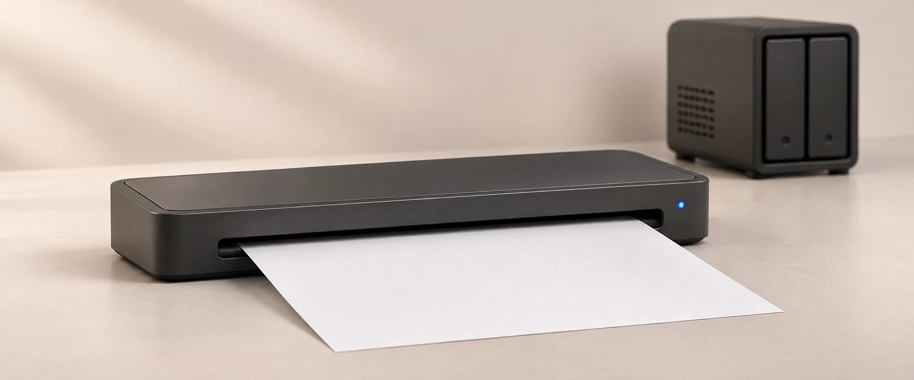
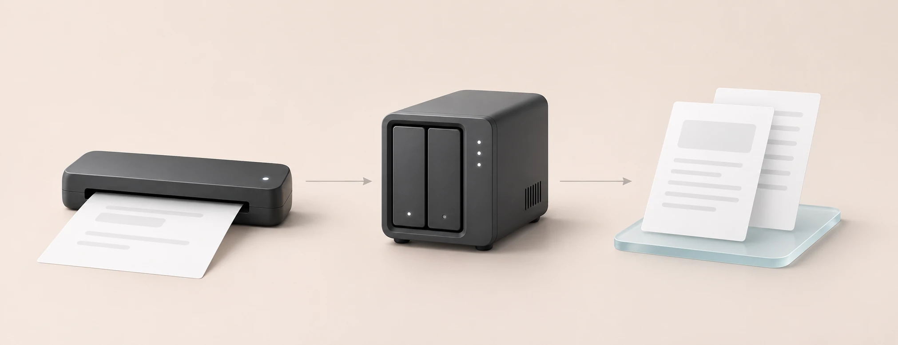

# Brother DS-940DW to NAS and Paperless-ngx

**Scan both sides of a document over Wi-Fi and save one PDF directly to your NAS.** The receiver sends finished files to a network share or to Paperless-ngx for OCR and search. Everyday scanning needs only the scanner and the NAS.

[Quick start](#get-your-first-pdf) · [Synology setup](docs/synology.md) · [Guides in other languages](#synology-guides)



## Use the scanner as your household inbox

Power on the DS-940DW and wait for `Ready for paper` in the receiver log. Insert one sheet face up. The receiver scans both sides in color at 300 dpi and saves them together. Let the sheet exit before feeding the next one, then power off the scanner when the batch is done.

| Where you want the PDF | How to use this project |
| --- | --- |
| An SMB share on your NAS | Run the receiver and point `SCAN_OUTPUT_DIR` at the share’s directory on the Docker host. |
| Your existing Paperless-ngx | Run the receiver and use the host directory mounted at `/usr/src/paperless/consume` in Paperless. |
| A new Paperless-ngx archive | Run the receiver and the included Paperless-ngx, PostgreSQL, and Valkey stack together. |

## Get your first PDF

Use a **Brother DS-940DW in Wi-Fi mode** and an **x86-64 Linux host with Docker Compose**, such as an amd64 Synology with DSM 7 and Container Manager. Connect the scanner to the same LAN and reserve its IPv4 address in your router. [Brother DS-940DW setup and support](https://support.brother.com/g/b/producttop.aspx?c=gb&lang=en&prod=ds940dw_us_eu_as)

Open the downloaded source folder. Create the working and output directories and copy the configuration template on first setup.

```sh
mkdir -p work consume
cp .env.example .env
```

Set `SCANNER_IP` in `.env`. Set `SCAN_UID` and `SCAN_GID` to an account or group that can write to the working directory and the chosen output directory. If you use a share or an existing Paperless instance, enter its host path in `SCAN_OUTPUT_DIR`.

```sh
docker compose config --quiet
docker compose up -d --build scanner
docker compose logs -f scanner
```

Power on the scanner, wait for the receiver to connect, and test a sheet marked on both sides. Open the PDF in the destination to check page order and completeness. [Synology setup and first-scan checks](docs/synology.md)

### Start a new Paperless-ngx stack

Create an `export` directory alongside `work` and `consume`. Set separate random values for `POSTGRES_PASSWORD` and `PAPERLESS_SECRET_KEY` in the local `.env`. Set `PAPERLESS_BIND_IP` to the NAS’s LAN address to reach the web interface from other devices.

```sh
mkdir -p export
docker compose -f compose.yaml -f compose.paperless.yaml config --quiet
docker compose -f compose.yaml -f compose.paperless.yaml up -d --build
```

Open Paperless on the configured address and port. The default port is 8010. Create the first administrator, then send a test scan. Paperless takes files from `consume` and shows imported documents in its web interface. [Paperless-ngx installation guide](https://docs.paperless-ngx.com/setup/)

## The receiver puts only complete PDFs in the destination



The container uses Brother’s `brscan5` driver through SANE. It opens a short Wi-Fi session to check for paper, then closes the session when the feeder is empty. On a successful scan, it stages both page images and builds a PDF in `work/spool`. It moves the completed file into the watched directory under its final name. Finished scans can be retried after a temporary write failure.

The spool also retains copies of delivered scans and partial data from failed scans. Review its disk usage and archive or remove old jobs after checking that the destination holds the document. [Spool and recovery on Synology](docs/synology.md#troubleshoot-the-receiver)

## A4 is the starting point for everyday scanning

| `SCAN_PAPER_SIZE` | Behavior |
| --- | --- |
| `a4` | Default fixed scan area of 210 × 297 mm. This is the format used for everyday scanning in the original home installation. |
| `auto` | Uses the driver’s document size detection. A roughly 35 cm receipt jammed in the original trial. |
| `legal` | Requests a fixed scan area about 355.6 mm long. The scanner accepted the geometry with an empty feeder. A full physical receipt scan in this mode is still unverified. Short sheets can have extra white space below the image. |

For paper longer than A4, close the top output guide and leave room for the sheet to exit straight. For receipts beyond the driver’s range, Brother provides a separate single-sided **Long Paper** mode in iPrint&Scan. [Supported documents](https://support.brother.com/g/b/faqend.aspx?c=us&faqid=faq00002914_005&lang=en&pfs=1&prod=ds940dw_us_eu_as) · [Brother Long Paper instructions](https://support.brother.com/g/b/faqend.aspx?c=gb&faqid=faq00100159_001&lang=en&prod=ds940dw_us_eu_as)

After extended idle time, the scanner can hold a busy session and report `-NG 401`. The receiver backs off and retries. If it stays busy, close other scanner clients and power-cycle the Brother. Switching it off between batches helps avoid leaving a session open. [Troubleshooting on Synology](docs/synology.md#troubleshoot-the-receiver)

## The project grew out of a scanner we almost returned

The DS-940DW was small enough to leave on a shelf and could scan both sides of a sheet. We wanted its Wi-Fi connection to deliver straight to our NAS. The receiver gave us that workflow and saved a trip to the post office with a return parcel. Now mail, invoices, and receipts go into our home archive as they arrive.

## Build and verify the receiver

```sh
python -m pip install -r requirements-dev.txt
python -m unittest discover -s tests -v
```

The tests cover duplex PDF output, Legal-sized frames, partial scans, retries, and connection recovery. CI checks both Compose configurations and builds the amd64 image. A separate Paperless-ngx 3.4.2 stack imported a synthetic duplex PDF from the receiver and recognized text on both pages. Use a marked sheet to verify your physical scanner after setup.

The Dockerfile fetches Brother’s pinned driver package and checks its SHA-256 during the build. Build the image for your own installation under Brother’s driver terms. Store deployment settings and scans in local runtime directories. [Brother driver downloads and terms](https://support.brother.com/g/b/downloadlist.aspx?c=gb&lang=en&prod=ds940dw_us_eu_as&os=128)

## Synology guides

[English](docs/synology.md) · [Polski](docs/i18n/pl.md) · [Deutsch](docs/i18n/de.md) · [Français](docs/i18n/fr.md) · [Español](docs/i18n/es.md) · [简体中文](docs/i18n/zh-CN.md) · [Русский](docs/i18n/ru.md)
