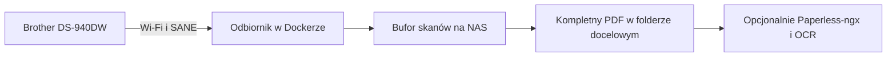

# Brother DS-940DW → NAS i Paperless-ngx

[Read in English](README.en.md) · [Instrukcja dla Synology krok po kroku](docs/synology.md)

**Włącz skaner, odczekaj chwilę i wsuń dokument.** Brother DS-940DW łączy się z domowym Wi‑Fi, a kontener na NAS zapisuje obie strony jako jeden PDF. Jeśli folder docelowy jest katalogiem importu Paperless-ngx, dokument trafia do archiwum i kolejki OCR. Cały codzienny obieg działa między skanerem i NAS-em, bez telefonu i aplikacji mobilnej.

## Skąd wziął się projekt

DS-940DW prawie trafił na pocztę w paczce zwrotnej. W tym poręcznym skanerze dwustronnym brakowało nam wygodnego zapisu na udział sieciowy. Mały odbiornik na Synology wykorzystał sterownik Brothera i oszczędził nam drogę na pocztę.

Teraz listy, faktury i paragony można skanować od razu po przyniesieniu do domu. Wkładamy jedną kartkę, czekamy na jej wysunięcie i wkładamy następną. Taki obieg daje nam na co dzień wygodę skanowania na NAS znaną z droższych urządzeń. Po sesji wyłączamy skaner.

## Jak to działa



Odbiornik otwiera krótką sesję SANE przez Wi‑Fi. Gdy podajnik jest pusty, zamyka sesję i ponawia próbę po chwili. Po wsunięciu kartki pobiera obie strony w kolorze przy 300 dpi. Dopiero kompletny PDF pojawia się pod końcową nazwą w folderze docelowym. Bufor zachowuje źródła, a gotowy PDF można przekazać ponownie po przejściowym błędzie zapisu.

## Szybki start

Potrzebujesz **Brother DS-940DW** w trybie Wi‑Fi, hosta **Linux x86‑64** z Docker Compose i katalogu, do którego odbiornik może zapisywać. Synology z DSM 7 i Container Managerem może pełnić rolę hosta. Zarezerwuj adres IPv4 skanera w routerze. Pierwsze połączenie skanera z siecią skonfiguruj według instrukcji Brothera. [Wsparcie DS-940DW](https://support.brother.com/g/b/producttop.aspx?c=gb&lang=en&prod=ds940dw_us_eu_as)

Przy pierwszym uruchomieniu przygotuj katalogi i konfigurację w pobranym repozytorium.

```sh
mkdir -p work consume
cp .env.example .env
```

Ustaw w `.env` adres `SCANNER_IP`. Dopasuj `SCAN_UID` i `SCAN_GID` do właściciela katalogów roboczego i docelowego. Następnie zbuduj i uruchom odbiornik.

```sh
docker compose config --quiet
docker compose up -d --build scanner
docker compose logs -f scanner
```

Po włączeniu Brothera poczekaj na komunikat `Ready for paper`. Zwykle potrzeba kilkunastu sekund. Po błędzie sterownika odbiornik może odczekać dłużej. Wsuń pojedynczą kartkę zadrukowaną stroną do góry. Skan rusza sam, a po jego zakończeniu w folderze pojawia się dwustronny PDF. Zakończ serię po pojawieniu się dokumentów i wyłącz skaner.

| Chcę skanować do… | Konfiguracja |
| --- | --- |
| Udziału SMB na NAS | Ustaw `SCAN_OUTPUT_DIR` na ścieżkę katalogu tego udziału widzianą przez hosta Dockera. |
| Istniejącego Paperless-ngx | Ustaw `SCAN_OUTPUT_DIR` na katalog hosta podpięty jako `/usr/src/paperless/consume` w Paperless. |
| Nowego Paperless-ngx | Użyj obu plików Compose zgodnie z przykładem poniżej. |

### Paperless-ngx od zera

Utwórz też `export`. W `.env` zapisz lokalnie losowe wartości `POSTGRES_PASSWORD` i `PAPERLESS_SECRET_KEY`. Ustaw `PAPERLESS_BIND_IP` na adres NAS w LAN, jeśli chcesz otwierać Paperless z innych urządzeń. Compose uruchomi odbiornik, Paperless-ngx, PostgreSQL i Valkey.

```sh
mkdir -p export
docker compose -f compose.yaml -f compose.paperless.yaml config --quiet
docker compose -f compose.yaml -f compose.paperless.yaml up -d --build
```

Otwórz Paperless na skonfigurowanym adresie i porcie, domyślnie 8010. Przy pierwszym wejściu utwórz konto administratora. Katalog `consume` jest kolejką, z której Paperless pobiera pliki po imporcie. Gotowe dokumenty znajdziesz w Paperless, a kopie robocze na NAS w `work/spool`. [Dokumentacja instalacji Paperless-ngx](https://docs.paperless-ngx.com/setup/)

## Długie paragony i sesja Wi‑Fi

- **Rozmiar papieru.** Domyślny tryb `a4` odpowiada codziennemu obiegowi sprawdzonemu w pierwotnej instalacji. `SCAN_PAPER_SIZE=auto` uruchamia rozpoznawanie rozmiaru. `SCAN_PAPER_SIZE=legal` ustawia stały obszar około **35,56 cm**. Sterownik przyjął oba ustawienia. Paragon około 35 cm zaciął się w próbie z `auto`. Pełny fizyczny skan w Legal pozostaje do potwierdzenia. Krótsze kartki w tym formacie mogą mieć biały margines u dołu.
- **Dłuższy papier.** Przy papierze ponad A4 zamknij górną prowadnicę wyjściową. Gdy paragon przekracza limit sterownika lub zacina się w Legal, Brother udostępnia osobny jednostronny tryb **Długi papier** w iPrint&Scan. [Dopuszczalne dokumenty](https://support.brother.com/g/b/faqend.aspx?c=us&faqid=faq00002914_005&lang=en&pfs=1&prod=ds940dw_us_eu_as) · [Instrukcja trybu Długi papier](https://support.brother.com/g/b/faqend.aspx?c=gb&faqid=faq00100159_001&lang=en&prod=ds940dw_us_eu_as)
- **Zajęta sesja.** Po dłuższej bezczynności skaner może zgłaszać zajętą sesję, m.in. `-NG 401`. Odbiornik robi przerwę i ponawia połączenie. Wyłączaj urządzenie po skanowaniu, a jeśli sesja utknęła, zamknij inne programy skanujące i wyłącz oraz włącz Brothera. [Diagnostyka i obsługa bufora](docs/synology.md#diagnostyka-i-obsługa-bufora)

## Testowanie i przegląd źródeł

```sh
python -m pip install -r requirements-dev.txt
python -m unittest discover -s tests -v
```

Testy używają sztucznych obrazów. Sprawdzają m.in. dwie strony PDF, pełny wymiar Legal, ponawianie przekazania i zachowanie częściowego skanu po błędzie. Workflow CI sprawdza też oba warianty Compose i buduje obraz amd64.

W osobnym stosie Paperless-ngx 3.4.2 odbiornik przekazał syntetyczny dwustronny PDF. Paperless zaimportował dokument i rozpoznał tekst po obu stronach. Przy nowym wdrożeniu wykonaj próbę z fizycznym skanerem. [Pierwszy skan na Synology](docs/synology.md#3-zrób-pierwszy-skan)

Dockerfile pobiera sterownik `brscan5` z serwera Brothera podczas budowy i sprawdza SHA-256. Sterownik podlega warunkom Brothera. Buduj obraz dla swojej instalacji. W repo są źródła i szablony konfiguracji, a ustawienia oraz skany pozostają w lokalnych katalogach. [Sterowniki i warunki Brothera](https://support.brother.com/g/b/downloadlist.aspx?c=gb&lang=en&prod=ds940dw_us_eu_as&os=128)
